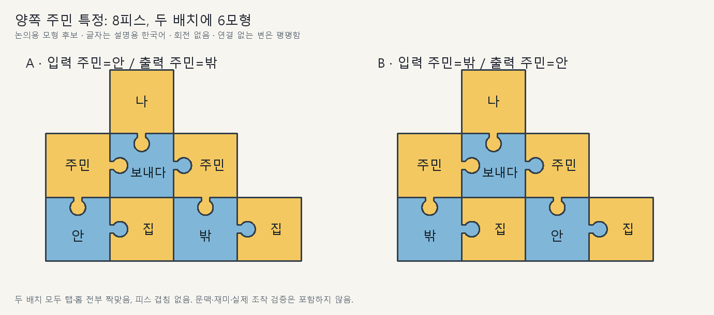

# 직소우 조립과 장면 검토 02

2026-09-26 · AI 추천·논의 중. 2026-09-27 후속에서 노랑 집→안의 직접 연결 방향만 사용자 확정으로 반영했다. 나머지 새 문법·색·장면은 후보이며 게임 구현 기록이 아니다. 기존 Unity 시험본의 구조를 제약으로 쓰지 않았다.

2026-09-27 후속: 사용자가 안/밖의 색과 ‘안에/안으로’의 차이를 지적했다. 아래 도면은 파랑 안/밖을 위치 서술로 가정한 이전 후보로 보존한다. 현재 추천은 노랑의 공간 개념과 파랑의 행동·상태를 구분하여 다시 비교하는 것이다. 물리 접합 검산을 의미 분류의 타당성 검증으로 취급하지 않는다.

## 이번 추천

**대상을 설명하는 작은 관계를 조립하고, 크리처가 제안한 계획을 상황에 맞게 고쳐 응답하는 방향**을 첫 확장으로 추천한다. 노랑 대상·파랑 행동/상태/관계를 유지한다. 보라는 두 사건 전체의 관계를 표현할 후속 후보로 둔다.

‘연결을 바꾸면 뜻이 달라진다’는 이미 합의한 원리다. 이번에 좁힌 것은 실제 낱개 외곽, 반복되는 명사의 지칭, 유효한 두 표현, 제안이 실패한 뒤의 행동이다. 아래 8피스 표본은 관계 조립을 설명하는 학습·비교 자료이며 후반 대표 퍼즐이나 재미 검증 완료안이 아니다.

## 같은 어휘로 만드는 두 조립

어휘는 `나·주민·보내다·안·밖·집` 여섯 종류다. 주민과 집을 두 번 써서 여덟 피스로 구성한다. 두 집 글자는 같은 건물을 가리켜도 된다. 복제 글자가 자동으로 다른 실물을 뜻하지 않는다.

| 구성 | 보내다의 동등 두 입력 | 보내다의 출력 |
|---|---|---|
| A | 나 + 집 안에 있는 주민 | 집 밖에 있는 주민 |
| B | 나 + 집 밖에 있는 주민 | 집 안에 있는 주민 |

새 후보 규칙은 **주민 → 안/밖 → 집이라는 위치 관계를, 전달에 참여하는 같은 주민에 연결할 수 있다는 것**이다. 이 표본은 요청을 듣는 시점의 위치로 대상을 식별한다. 이후 주민이 이동해도 실행 중 대상이 다른 주민으로 바뀌지 않는다. 과거 발화의 참조와 새 요청 시점의 참조는 구별한다.

기본 배치는 정사각형 모형 6종을 반복 사용한다. 각 배치에서 8피스·7접합이며 회전은 없다. 평면끼리 닿는 것은 연결로 읽지 않는다. ‘위=주어’처럼 읽는 위치 규칙을 추가한 것이 아니다. [모형·좌표](독립검토02/모형과배치.json).

보내다의 두 입력은 여전히 동등하다. A만으로는 내가 안 주민을 보내는지, 안 주민이 나를 보내는지가 확정되지 않는다. 준비 동작·대화 목적·후속 행동을 함께 읽는다. 같은 동등 입력끼리 자리만 바꿨다고 행위자/대상이 바뀐 것으로 판정하지 않는다. 그 구별이 플레이에 필요한 장면에는 조작부를 잡는 쪽/탑승하는 쪽처럼 역할을 구별할 단서가 필요하다.

## 2026-09-27: 관계를 합쳐 읽는 범위 — 후보 규칙의 설명 보완

사용자는 B를 ‘나는 주민을 집 안으로 보낸다 / 주민은 집 밖에 있다 / 주민은 주민을 집 안으로 보낸다’라는 세 문장으로 읽고, 합치거나 나누는 것이 문맥에 달렸는지 질문했다. 도식에는 연결만 있고 한 관계의 범위를 읽는 규칙이 충분히 설명되지 않았다.

- 이 B안에서 의도한 것은 보내기 한 건과 두 주민의 위치 관계다. 같은 보내다 조각에 붙은 참여자를 함께 읽으며, 조각에 이르는 경로마다 별도의 보내기를 만들지 않는다는 가정이 있었다. 이것을 외곽만으로 자명한 규칙이나 이미 채택된 문법으로 취급하지 않는다.
- 왼쪽 주민은 집 밖, 오른쪽 주민은 집 안에 있다. 보내다의 직접 출력은 오른쪽 주민이다. ‘집 안으로’라는 이전 요약은 직접 목적지와 그 위치에 있는 상대를 구별하지 못한 설명이므로, 정확히는 ‘집 안의 주민에게’로 읽는다.
- 전체 해석 후보는 ‘내가 집 밖 주민을 집 안 주민에게 보낸다’ 또는 ‘집 밖 주민이 나를 집 안 주민에게 보낸다’다. 후자에서 보내지는 대상은 나다. 위치 두 관계를 따로 말로 풀어 설명할 수는 있지만, 전체 조립을 읽을 때 그 연결을 버리거나 보내다를 별개의 두 사건으로 늘리지 않는다.
- 메인 추천: 조립이 정하는 관계·공유 대상의 범위는 유지하고, 그 구조 안에서 남는 역할·지칭·요청/보고 등의 해석을 문맥으로 좁힌다. 구조가 합쳐지는지 분리되는지까지 매번 문맥으로 바꾸는 방식은 기본형으로 추천하지 않는다. 사용자의 해당 읽기 규칙 채택은 아직 없으며, 새 색·장면 확장 전에 이 경계를 먼저 논의한다.

## 2026-09-27: 안/밖의 색과 뜻 범위 재검토

- 사용자 질문: 안/밖은 동작·서술 자체가 아니며 안에/안으로에 따라 해석이 달라지므로 노랑이 더 맞는가? 아직 색 배치의 확정 지시가 아니라 설계 논의다.
- 이전 안은 글자 뜻을 ‘안/밖’이라고 소개하고 판정에는 ‘X가 Y 안/밖에 있다’라는 위치 서술을 넣었다. 공간을 지칭하는 뜻과 두 대상 사이의 상태를 서술하는 뜻을 구별하지 않은 것이 문제다. 파랑의 기본 뜻을 처음부터 ‘안에 있다’로 정의하는 안은 가능하나 공간·방향의 재사용 범위가 달라진다.
- 메인과 독립 검토의 현재 추천: ‘안쪽/바깥쪽’은 노랑 공간 대상으로 우선 비교한다. 집+안쪽을 집 내부 공간을 지칭하는 묶음으로 구성하고, 그 공간이 현재 위치인지 이동 목적지인지는 연결된 행동·상태와 문맥으로 좁히는 방향이다. 집과 안쪽을 묶는 구체 문법·외곽은 아직 미정이다.
- ‘주민이 집 안에 있다’와 ‘주민이 집 안으로 간다’는 공간 대상의 뜻을 유지하면서 상태·이동 관계가 달라지는 설명 예다. 같은 행동에서도 장소/방향 해석이 남을 수 있으므로, 행동 글자 하나가 항상 에/으로를 유일하게 정한다고 일반화하지 않는다. 조사 조각이나 위치/이동 전용 글자를 즉시 필수 신설하지 않는다.
- 노랑으로 다시 칠하는 것만으로 기존 도면의 뜻이 보존되지는 않는다. 주민의 현재 위치를 설명하는 구조와 이동 목적지를 가리키는 구조를 먼저 구별해 설계한다. 기존 도면은 기하 참고로 남기고 새 색/뜻 범위가 채택되기 전 게임 문법으로 승격하지 않는다.

## 2026-09-27: 노랑 묶음의 방향과 설명 단순화

- 사용자는 집 안을 노랑 두 개의 직접 연결로 만드는 것을 전제로, 집→안/안→집 중 어느 방향이 나은지 질문했다. 별도 묶음 피스나 새로운 색을 요구하지 않는다.
- 후속에서 사용자가 집→안 방향을 확정했다. 노랑 집→노랑 안을 직접 연결하여 집의 안쪽으로 읽는다. 화살표는 끼움 방향이며 화면의 좌→우 읽기 순서나 이동 방향이 아니다. ‘기준 대상→그 대상의 부분/영역’이라는 설명과 주민→손 같은 확장 예시는 참고이며, 모든 노랑 연결을 이 관계 하나로 확정한 것은 아니다.
- ‘현재 위치/이동 목적지’라는 앞선 표현은 ‘주민이 집 안에 있다’와 ‘주민이 집 안으로 간다’의 차이를 뜻했다. 같은 집→안 묶음을 두 표현에 재사용하고, 함께 쓰는 행동·상태와 문맥으로 관계를 읽는다는 설명이다. 집 안 묶음 자체를 두 종류로 만들거나 새 조사 조각을 필수로 추가하자는 뜻이 아니다. 구체 모형과 전체 문법 채택은 아직 미정이다.
- 후속 조사 질문에 대한 AI 추천: 이 장면에서 ‘집 안에 가다/집 안으로 가다’를 같은 이동으로 이해했다면 한국어 풀이 차이는 허용한다. ‘집 안에서 뛰다/집 안으로 뛰다’처럼 실제 행동이 달라지는 해석은 구조가 허용하는 범위에서 현재 위치·동작·앞선 발화로 구별하게 한다. 단서가 부족하면 하나만 숨은 정답으로 삼지 않고 타당한 해석을 허용하거나 추가로 확인할 기회를 둔다. 모든 에/으로 표현을 동의어로 묶거나 집→안의 고정 관계를 문맥으로 뒤집는다는 뜻이 아니다. 전체 한국어 문장을 입력받는 기능도 제안하지 않는다.

## 2026-09-27: 조사 관계를 맥락으로 읽는 부담 검토

사용자는 조사에 해당하는 관계를 모두 맥락으로 해석하게 하는 것이 의도라고 명시하고, 플레이어의 귀찮음과 제작 부담을 질문했다. 아래는 jigsaw_scene의 플레이 관점, jigsaw_geometry의 판정·제작 관점 독립 검토와 메인 추천이며 사람 플레이 검증 결과는 아니다.

- **추천:** 이 방향을 유지하되, 평소에는 익숙한 상황·발화 습관으로 쉽게 이해하고 중요한 퍼즐에서 관계를 다시 판단하게 한다. 구조와 단어가 해석 범위를 제한하고 문맥이 그 안에서 뜻을 좁힌다. 언어를 읽지 않아도 항상 답이 드러날 정도로 행동을 모두 보여주지는 않는다.
- **제작 부담:** 중요한 중의적 장면에서는 허용할 해석, 플레이어가 볼 단서, 행동 결과를 함께 설계해야 한다. 어휘×조사마다 전용 연기가 필요한 것은 아니다. 위치·소유·접촉 상태와 시선·몸 돌리기·물건을 내밀기 같은 반응을 재사용할 수 있다. 이 표현으로 구별되지 않는 핵심 관계에는 추가 발화나 별도 행동이 필요하다. 재사용 가능성은 비용 절감 후보이며 제작 시간은 미실측이다.
- **양방향 소통의 한계:** 같은 조립과 같은 관찰 상황에서 정반대 의도를 요구하면 플레이어도 게임도 그 차이를 식별할 수 없다. 특히 플레이어가 말할 때 속뜻을 자동 판독한다고 가정하지 않는다. 앞선 상호작용·추가 발화로 의도를 구별하거나 타당한 복수 해석을 허용하고, 결과가 중요한 경우 상대의 행동 의도를 알아차리고 수정할 여지를 설계한다. 모든 대화에 확인 버튼이나 새 시스템을 강제하는 제안은 아니다.
- **현실적인 판정:** 필요한 유한한 어휘·구조와 장면에서 성립하는 해석 후보를 정의한다. 내부 상태로 후보를 구별하더라도 그 상태 차이가 플레이어에게 관찰 가능해야 한다. 숨은 정답으로만 의미를 선택하거나 모든 한국어 조사를 범용 AI로 해석하는 접근은 요구하지 않는다.
- **다음 비교:** 같은 보내다 조립에서 행위자/이동 대상을 다르게 읽어야 하는 두 상황과 구별 단서가 없는 상황을 비교한다. 크리처가 말할 때와 플레이어가 답할 때 각각 무엇을 보고 해석하고 무엇으로 의도를 전달할지 적는다. 구조·글자·상황이 모두 같은데 서로 다른 답을 요구하는 경우는 단서나 표현을 보완할 대상으로 표시한다. 반복 활용과 고유 반응을 함께 세고, 이 설계 비교를 실제 자연스러움·재미의 실측으로 부르지 않는다.
- 위 비교의 설계 검토는 [문맥 비교 03](문맥비교03_검토와추천.md)에 진행했다. 이력 없는 검토자 2명에게 관찰 자료만 제공해 읽기·직접 발화·단서 부족을 비교했다. 몸짓만으로 행동을 아는 것을 문장 이해로 채점할 수 없다는 반박을 반영했다. 다음 비교를 게임 구현 승인이나 완료된 사람 플레이 검증으로 읽지 않는다.

## 어디에 쓰는가: 상대가 제안한 만남을 수정하기

검토용 가정: 플레이어는 밖 주민에게 접근해 정보를 얻고 싶지만 경계당한다. 안 주민은 플레이어와 소통할 수 있고 밖 주민과도 아는 사이이며, 밖 친구를 안으로 부르자는 제안을 한다. 플레이어는 밖 주민이 좁은 입구를 지나지 못하는 모습을 먼저 보았다. 안 주민은 출입할 수 있다. 모두 새 장면 후보이며 본편 인물·지역의 확정이 아니다.

단어와 필요한 낱개 모형은 이전 발화에서 이미 발견한 것으로 놓는다. 처음부터 여덟 피스를 모두 배우게 하는 도입 튜토리얼이 아니다. 플레이어의 새 판단은 **‘원하는 만남은 유지하면서 누가 어느 상대 쪽으로 가야 하는가’**다. 상대 발화의 문법이 틀린 것이 아니라 제안한 행동이 상황에 맞지 않는 것이다.

| 플레이어의 제안 | 이번 문맥에서의 반응 | 얻는 정보·다음 행동 |
|---|---|---|
| A의 관계로 안 주민을 밖 주민에게 보내기 | 안 주민이 바깥으로 나가 익숙한 인사를 하고 플레이어를 가리킨다. 밖 주민이 막던 자세를 푼다. | 플레이어가 직접 접근해 대화를 잇는다. ‘소개’는 두 주민의 관계에서 생기는 후속 행동이며 보내다 글자의 숨은 뜻이 아니다. |
| B의 관계로 밖 주민을 안 주민에게 부르기 | 안 주민의 호출에 밖 주민이 다가오지만 입구에서 멈추고 다시 바깥으로 물러난다. | 누구에게 이동을 요청했는지, 왜 이 만남의 위치가 맞지 않는지 행동으로 드러난다. 두 주민에게 다시 접근해 제안을 바꿀 수 있다. |

위 반응은 입력 역할이 해당 이동 제안으로 해석되는 문맥에서의 예다. 다른 역할 해석도 현재 행동·목적과 양립한다면 부당하게 오답으로 처리하지 않는다. 자기를 가리키며 일어나는 동작 하나만으로 모든 역할을 유일하게 알 수 있다고 주장하지 않는다.

입구에서 멈춘 것은 말의 문법 오류가 아니라 실행 조건의 실패다. 반응이 단어 의미를 구별할 실제 사용 근거가 된다면, 맞는 뜻 가설과 함께 기본 뜻을 확인할 수 있다. 임무 성공을 뜻 확인의 필수 조건으로 바꾸지 않는다. `?` 사용, 늦은 추측, 재접근은 현행 설계를 유지한다.

## 강제하면 안 되는 것과 이 표본의 한계

- A와 B는 안/밖 글자만 바꿔도 서로 전환된다. 가지를 통째 이동시키거나 외곽을 반드시 교체해야만 성공하게 만들지 않는다.
- 다른 외곽의 B도 실제로 조립된다. 추가 모형 2종으로 출력 주민의 가지를 위로 배치했다. [다른 유효 외곽](다른외곽도_허용02.png). 여섯/여덟 모형은 이 표본의 집합이며 본편 최소 총수가 아니다.
- 이 장면처럼 주민이 둘이고 몸짓으로 지칭까지 충분히 알 수 있다면 짧은 발화도 통할 수 있다. 여덟 피스를 강제하면 불필요한 조립이다. 짧은 동등 표현을 허용한다.
- 따라서 새 구조의 가치는 ‘기존 4피스 골격에서 같은 주민에 위치 관계까지 붙이는 구성’에 있다. 완성된 두 안을 비교하는 것만으로 독립적인 공간 맞추기 재미나 후반 깊이를 입증하지 못한다. 처음에는 작은 관계 구성 학습, 이후에는 상대의 계획을 읽고 수정하는 사건에 사용한다.
- 이 표본을 모든 크리처가 틀린 계획을 내는 공식으로 확대하지 않는다. 처음부터 문장이 충분히 통하는 대화도 유지한다. 상대 발화를 플레이어 답으로 복사할 때 나/너의 화자 기준을 말없이 유지하는 UI도 확정하지 않는다.

## 색과 종별 변주의 연결

| 후보 | 실제로 새로 판단하는 것 | 추천 |
|---|---|---|
| 노랑·파랑의 위치/상태 가지 | 같은 대상을 어느 관계에 참여시키고 어떤 대상을 특정할지 | 첫 확장. 위 표본으로 물리 조립과 의미 연결을 확인 |
| 보라: 두 사건 사이의 선후 | 한 사건 전체를 다른 사건보다 먼저 실행하도록 사전 계획 전달 | 후속 협동 장면. 두 행동을 따로 말해 같은 결과가 나면 긴 조립을 강제하지 않음 |
| 부정·한정의 범위 | 어느 상태/사건을 부정하고 무엇을 남기는지 | 뒤로 둠. ‘안에 있지 않다’와 ‘보내지 마라’의 판정·반응은 별도 설계 필요 |

보라는 색 자체가 ‘먼저’라는 뜻이 아니다. 색은 사건 전체 사이의 관계를 다루는 종류, 글자는 구체 관계다. 처음부터 상태·조건·부정 전체에 같은 완료 규칙을 씌우지 않는다.

종·개체별 차이는 공통 문법을 유지하며 읽을 정보를 바꾼다. 준비 동작을 먼저 보여주는 개체는 몸과 발화를 연결해 읽고, 상대 말 일부를 바꾸어 새 제안을 하는 개체는 유지된 관계와 바뀐 관계를 비교한다. 이를 종별 정답 공식이나 모든 크리처의 문장 자동 교정으로 만들지 않는다.

## 필요한 제작과 검토 결과

- 공용 반응: 대상 보기, 가까이 이동, 호출/인사, 이동 중단, 자리로 돌아감. 같은 종에서 대상·목표점·경로를 바꾸어 재사용할 후보이며 이식이 완료됐다는 뜻은 아니다.
- 장면 전용: 밖 주민의 몸과 입구 간 크기 관계, 지나갈 수 없음을 보여주는 정지 자세, 두 주민의 친숙함을 보여주는 인사. 전용 애니메이션 없이도 읽히는지 실제 카메라에서 확인할 대상이다.
- 필요한 데이터: 발화 시점의 지칭 대상, 이동 가능한 경로, 현재 소통 상태, 요청 후 반응. 단계별 거절 이유를 한국어 정답 해설로 대신하지 않는다.
- 구조 에이전트는 돌출/홈 다각형·접합·충돌을 검산했다. 장면 에이전트는 한쪽 대상만 특정하던 앞선 예시와 여덟 피스 강제의 문제를 지적했다. 변주 에이전트는 사건 순서를 미리 합의할 필요가 있는 협동에서 보라를 쓰도록 권했다. 메인은 8피스를 핵심 후반 퍼즐로 포장하지 않고 관계 학습 표본으로 좁혔다.
- 메인 재확인: A/B/다른 외곽 B 각각 8피스·7접합, 겹침 0·미짝 연결부 0. 입력 주민의 추가 탭을 없앤 대조는 미짝 연결부 1개·분리된 가지를 검출했다. [검사 결과](독립검토02/주요배치_메인검산.json). 모형 6종의 기하 성립을 확인한 것이며, 게임 조작·초견 이해·재미·새 본편 구현을 검증한 것이 아니다.

다음 설계 쟁점은 이 관계 구성이 사용자 의도에 맞는지와, 더 깊은 조립 판단을 만드는 공유·묶음·사건 연결 중 무엇을 확장할지다. 새 후보를 사용자 채택으로 기록하지 않고 기존 구현 작업을 재개하지 않는다.
