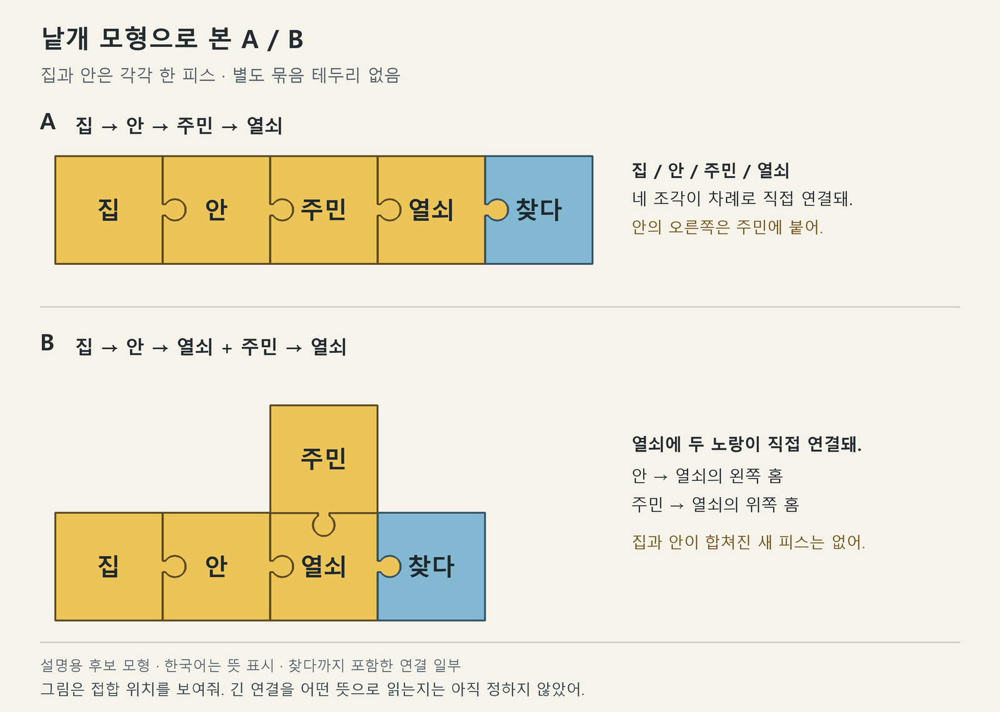

# 조립 규칙 04 — 노랑 분기와 설명의 적용 범위

2026-09-27 · 시스템 논의용 AI 추천. 사용자 요청은 문맥 장면 비교를 마치고 직소우 시스템 논의를 계속하는 것이다. 아래 분기 규칙·추가 어휘·외곽은 아직 사용자 채택이나 게임 구현 기록이 아니다.

## 사용자 지적에 따른 정정 — 2026-09-27

사용자는 ‘집과 안을 한 덩어리로 적용하는 규칙은 설계한 적이 없으며, A는 집→안→주민→열쇠로 배치된 것 아닌가’라고 지적하고 낱개 모형을 요청했다.

- **A는 집→안→주민→열쇠라는 네 낱개 노랑의 직접 연결이다.** 집과 안이 합쳐진 새 피스나 별도 그룹 객체를 뜻하지 않는다.
- 확정된 것은 집→안 직접 연결을 집의 안쪽으로 읽는 방향이다. 두 피스를 자동으로 한 묶음으로 취급하고 그 묶음 전체를 뒤 피스에 적용하는 범위 규칙이나 일괄 이동 기능은 정한 적이 없다.
- 앞선 `[집→안]` 표기와 ‘덩어리를 떼어 옮긴다’는 설명은 미정인 합성 범위·조작을 섞었다. 아래 도식은 괄호 없이 낱개 연결로 정정하고, 제시했던 전체 뜻은 **추가 가정이 필요한 후보 해석**으로 남긴다. 접합이 가능하다는 사실만으로 그 해석이 확정되지 않는다.
- 다음 쟁점은 이 낱개 연결을 어디까지 어떤 뜻으로 이어 읽는가다. 이 점을 건너뛰어 빈 연결부의 허용/금지부터 확정하지 않는다.



도면은 회전 없이 고정된 방향의 설명용 모형을 사용했다. A/B 각각 5피스·4접합이며 본체 겹침 없이 돌출/홈이 대응한다. 한국어는 설명용 뜻 표시이고, 찾다를 포함한 문장 일부만 그린 것이다. 게임의 기존 모형 채택·완전한 문법·해석을 검증한 결과는 아니다. [벡터 원본](낱개연결04_모형.svg), [접합 검사](낱개연결04_접합검사.json).

## 사용자의 후속 읽기 — 행위자와 소유 관계를 구별

사용자는 현재 맥락에서 A를 ‘집 안에 있는 주민이 열쇠를 찾다’, B를 ‘집 안에 열쇠를 찾다’와 ‘주민이 열쇠를 찾다’라는 두 갈래가 합쳐진 ‘주민이 집 안에 있는 열쇠를 찾다’로 읽고, 앞선 제안이 이것인지 질문했다. 맥락에 따라 다른 읽기가 가능하다는 전제를 직접 밝혔다. 최종 문법 채택 지시는 아니다.

- 공간의 설명이 A에서는 주민, B에서는 열쇠에 연결된다는 구별은 이전 제안과 공통이다. 그러나 이전 AI 설명의 주민은 열쇠의 소유·소지·담당 등과 관련된 사람이었고, 사용자 읽기의 주민은 찾는 행동의 행위자다. 두 읽기를 같은 것으로 소급 기록하지 않는다.
- 메인 추천은 사용자의 읽기를 대표 후보로 놓고 규칙을 정리하는 것이다. 노랑끼리 붙었다고 모든 관계를 소유·수식으로 고정하지 않고, 행동에 참여하는 대상들의 역할을 맥락으로 읽는 의도와 연결한다. 이 읽기를 수용하려면 파랑에 간접 연결된 주민도 같은 행동의 참여자로 읽을 수 있어야 한다. ‘파랑에 직접 붙은 노랑만 참여한다’는 제한은 확정 규칙이 아니다.
- B의 두 갈래는 같은 열쇠 조각과 같은 찾다 조각으로 합류한다. 사용자 풀이에서는 서로 다른 두 찾기를 실행하는 것이 아니라 같은 열쇠를 찾는 한 행동을 함께 설명한다. 이는 이 표본의 후보 해석이며 모든 분기의 사건 경계를 확정한 것은 아니다.
- 아직 보류: 모든 주민→열쇠 연결의 주민을 주어로 고정하거나, 안→열쇠를 모든 맥락에서 열쇠의 실제 위치로 유일 판정하지 않는다. 같은 조립의 다른 맥락상 해석을 닫지 않는다.

## 앞서 제안한 쟁점 — 범위 규칙 미정

**노랑 대상 하나에 여러 설명을 함께 연결할 수 있게 하는 안**을 먼저 추천한다. 이미 합의한 ‘연결을 바꾸면 표현이 달라진다’를 새 원리로 제안하는 것이 아니라, 그 연결이 어느 대상까지 적용되는지와 실제로 필요한 접합 수를 구체화한다.

새 색보다 이 규칙을 먼저 보는 이유는 대상을 어떤 관계로 묶는지가 행동 묶음의 연결에도 기반이 되기 때문이다. 보라 사건 관계와 크리처별 발화 습관은 기존 후보로 유지하며 이번에 함께 확정하지 않는다. 기존 회전 금지·글자/외곽 분리·발견 모형의 무제한 재사용은 유지한다.

## 같은 네 글자의 두 구조

설명용 어휘는 집·안·주민·열쇠다. 본편 어휘 확정이 아니다. 두 경우 모두 열쇠를 파랑 행동(예: 찾다)에 연결하는 상황으로 비교한다. 아래는 낱개 피스의 연결 설명도이며 전체 문장·최종 외곽 도면은 아니다.

```text
A: 집 → 안 → 주민 → 열쇠 ─ 파랑 행동
B: 집 → 안 → 열쇠 ← 주민
              │
           파랑 행동
```

- **A에 의도했던 후보 해석:** 집 안에 있는 주민과 관련된 열쇠. 이 해석을 채택한다면 주민의 위치가 열쇠의 위치로 자동 전파되지는 않는다. 현재 확정한 집→안의 뜻만으로 이 전체 해석이 자동 도출되지는 않는다.
- **B에 의도했던 후보 해석:** 주민과 관련된 열쇠 중 집 안에 있는 것. 이를 성립시키려면 각 연결의 뜻과 같은 열쇠에 두 관계를 적용하는 범위를 정해야 한다.

주민과 열쇠의 관련성은 관찰이나 대화로 알아야 한다. 소유·소지·담당 중 하나를 모든 노랑 연결의 보편 의미로 확정하지 않는다. 어느 열쇠가 누구와 관련됐는지 알 수 없는 장면에서는 구조만으로 답을 고를 수 없다. 여러 열쇠가 두 조건을 만족하면 지칭도 여전히 여러 개 남는다.

집→안의 방향과 ‘집의 안쪽’이라는 뜻은 사용자 확정대로 유지한다. 안→주민/열쇠를 이 장면의 위치 설명으로 읽는 것은 후보 용례다. 다른 어휘 연결의 뜻을 자유롭게 매번 발명하는 허용 규칙이 아니다.

## 앞서 검토한 범위 규칙 후보 — 현재 확정 규칙이 아님

1. **연결을 여러 개 받은 같은 노랑 한 조각은 같은 대상 하나를 가리킨다.** B에서 집 안에 있는 열쇠와 주민 관련 열쇠가 서로 다른 물건인 것으로 쪼개 읽지 않는다. 같은 글자를 다른 조각에 복제했다고 반드시 다른 물건이 되는 역규칙도 추가하지 않는다.
2. **설명은 직접 붙은 대상을 좁힌다.** A의 위치 설명은 주민에 붙고, 그 주민과 관련된 열쇠를 지칭한다. 주민의 위치를 열쇠의 위치까지 자동으로 옮겨 붙이지 않는다. 긴 연결의 앞 정보는 관련된 대상을 식별하는 데 이어 쓰이지만 뒤의 모든 대상에 같은 속성이 복사되지는 않는다.
3. **같은 대상에 붙인 여러 설명은 함께 적용한다.** B에서는 주민과의 관련성과 집 안 위치를 둘 다 만족하는 열쇠를 말한다. 여러 설명을 OR·선후·조건문으로 자동 읽지 않는다.
4. **파랑과 직접 접합한 노랑이 그 행동에 참여하는 지칭 대상이다.** 그것만으로 항상 주어·목적어·목적지가 된다고 정하지 않는다. 동등한 입력의 역할과 조사 풀이를 문맥으로 읽는 기존 의도는 유지한다. 이번 표본은 파랑 하나에 연결한 대상 가지 범위이며, 복수 파랑의 공유·사건 순서 전체를 확정하지 않는다.

## 실제 모형 선택과 남는 문제

| 접합이 생기는 노랑 | A | B |
|---|---|---|
| 열쇠 | 주민, 파랑 행동에 접합: 2개 | 집 안, 주민, 파랑 행동에 접합: 3개 |
| 주민 | 집 안, 열쇠에 접합: 2개 | 열쇠에 접합: 1개 |

B의 열쇠에는 세 접합을 수용하는 모형이 필요하다. 현재 도면에서 바뀌는 것은 안의 직접 접합 대상과 주민·열쇠의 모형이다. 조각 여러 개를 한 번에 떼거나 옮기는 기능은 이 도면에 포함하지 않는다. 후속 도면의 A/B에 한해 돌출·홈의 대응과 본체 겹침 없음을 확인했다. 이 예시의 물리 배치 확인을 문장 해석이나 본편 모형 채택으로 확대하지 않는다.

남는 연결부를 무시할 수 있는 범용 모형이 있으면 A에서도 같은 모형을 계속 쓸 수 있다. 이때 외곽 선택의 필요성은 약해질 수 있다. **사용하지 않은 홈·돌출부가 있어도 발화할 수 있는가, 있다면 무엇을 뜻하는가**는 후속 문제로 남긴다. 사용자 지적에 따라 현재는 낱개 연결의 뜻과 적용 범위를 먼저 구별한다. 모형 선택을 강제로 만들기 위해 빈 연결부 금지·좁은 판·소모성 피스부터 도입하지 않는다.

이 표본은 접합 구조의 차이를 보여주고, 그 차이에 어떤 뜻을 부여할지 제안한 것이다. 현재 규칙만으로 두 해석이 성립한다고 검증한 결과는 아니다. 더 짧고 같은 뜻으로 통하는 표현을 막거나 특정 외곽만 정답으로 삼지 않는다. 공간 맞추기의 재미, 조작의 손맛, 새로운 색의 필요성을 확인한 결과도 아니다.

## 독립 검토와 반영

- `concept_c`는 노랑 묶음이 파랑과 만나는 접점을 먼저 정리하고 사건 관계 색은 후속으로 둘 것을 추천했다. 대화·종별 규칙을 동시에 늘리는 것은 피했다.
- `jigsaw_geometry`는 최초의 집→안→주민 / 주민→집→안 예시가 글자 순서만 바뀌어 구조 선택의 깊이가 약하다고 지적했다. 메인은 같은 네 글자에서 선형 구조와 분기가 구별되는 현재 A/B로 수정했다.
- 후속 검토는 현재 A/B의 적용 범위에 모순이 없다고 보면서, 같은 대상·조건의 동시 적용·위치의 무단 전파 금지를 명시할 것을 요구했다. 위 추천 규칙에 반영했다.
- 같은 검토는 남는 연결부가 있는 범용 모형이 외곽 선택을 약화할 수 있다고 지적했다. 메인은 이를 후속 쟁점으로 유지하며 임의 완성 조건을 지금 확정하지 않았다. 에이전트 판단은 물리 접합이나 실제 사람의 재미를 검증한 결과가 아니다.
- 사용자 지적 후 `jigsaw_geometry`는 집→안의 확정된 뜻과, 그 앞부분 전체가 뒤의 대상을 수식한다는 미정 규칙을 구별했다. 앞의 범위 검토는 후보 규칙을 가정했을 때의 일관성 검토였으며 기존 확정 규칙에서 자동 도출된다는 증거가 아니었다. 메인은 그 구별을 본문과 현재상태에 반영했다.
